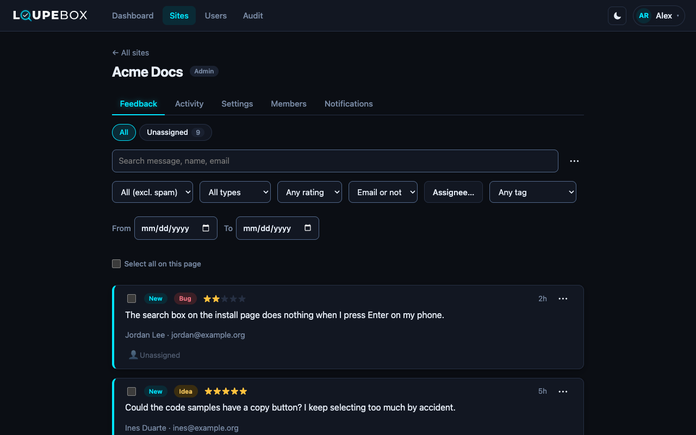

<p align="center">
  <picture>
    <source media="(prefers-color-scheme: dark)" srcset="web/public/brand/loupebox-wordmark-neon-dark.svg">
    
  </picture>
</p>

# Loupebox

Loupebox is a feedback inbox you run yourself. Visitors send a message from a form or a small widget on your
website. You and your team read it, sort it, reply to it and get an email when something new comes in.



**Documentation: <https://loupebox.dev>**

> **Alpha software.** Expect rough edges and changes between `0.x` releases. Read the
> [changelog](CHANGELOG.md) and back up your database before you upgrade. Run one API container only, replies
> are one way, and it has not been load tested.

## Try it

You need Docker with the compose plugin, plus `curl` and `openssl`.

```bash
mkdir loupebox && cd loupebox
for f in docker-compose.yml setup.sh env.example; do
  curl -fsSLO https://github.com/jonp92/loupebox/releases/latest/download/$f
done
sh setup.sh && docker compose up -d
docker compose run --rm api python -m scripts.create_superadmin you@example.com
```

Open <http://localhost:8080> and sign in. The [install guide](https://loupebox.dev/install/docker/) covers
the rest, including how to put it on the internet.

## What it does

* A feedback widget or your own form, on as many sites as you like.
* An inbox with filters, assignees, tags, private notes and CSV export.
* Replies by email to the person who wrote in.
* Email and webhook alerts for new feedback.
* Roles per site, optional two-factor sign-in and an audit log.
* Spam checks that need no CAPTCHA.
* An admin app that works on phones.

## Project

* Docs source is in [`docs/`](docs) and is built with [Zensical](https://zensical.org).
* Report bugs and ask questions in [issues](https://github.com/jonp92/loupebox/issues). Report security
  problems as described in [SECURITY.md](SECURITY.md).
* To contribute, read [CONTRIBUTING.md](CONTRIBUTING.md). Commits need a DCO sign-off.

## License

Copyright 2026 Jonathan L. Pressler. Loupebox is licensed under the [GNU AGPL-3.0](LICENSE). The embeddable
widget (`web/widget/`) is licensed under [Apache-2.0](web/widget/LICENSE).
